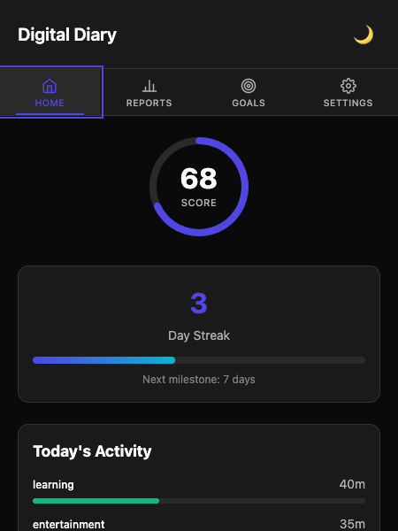

# Digital Diary
**CS50x 2025 Final Project** · **Video:** https://youtu.be/ZR7ZmUQUYdw

Digital Diary is a Chrome extension (Manifest V3, plain JavaScript, no build step) that shows where your time online goes: time per site and per category, a daily productivity score, streaks, focus sessions and reports. Your browsing data is stored only in your browser. Two optional features send data to outside services, and only when you click their buttons (see [Network requests](#network-requests)).



---

## What it does

- **Tracks time on the active tab** of the focused Chrome window and logs it per site. Time stops counting when you switch away from Chrome, lock the screen, or stop using the computer for 60 seconds.
- **Categorises sites** (learning, productive, entertainment, social media, shopping, misc) from a built-in list. `www.` and `m.` are ignored and subdomains fall back to their parent (`en.wikipedia.org` → `wikipedia.org`). **You can change any site's category** from the popup's Top Sites list; your choice is used everywhere.
- **Productivity score** (0–100) for today, weighted by time per category.
- **Streaks**: consecutive days on which your learning/productive time reaches your daily goal (default 30 minutes).
- **Focus sessions** (5–480 min) that keep running with the popup closed. When one ends you get a notification saying how many minutes went to learning/productive sites.
- **Reports** for today, this week, this month or a custom date range, downloadable as a `.txt` file.
- **Optional:** "Summarize this page" with Google Gemini (off by default) and "Export to Notion".
- **Achievements**, a 7-day heatmap, light/dark/system theme, JSON export, automatic deletion of old data.

Every button and setting, and the test that checks it, is listed in [docs/CONTROLS.md](docs/CONTROLS.md).

## Install

1. Download or clone this repository.
2. Open `chrome://extensions/` and turn on **Developer mode** (top right).
3. Click **Load unpacked** and select the repository folder.
4. Pin the extension and browse. Click the icon to see your day.

No build or `npm install` is needed to use the extension (npm is only used for the tests).

### Gemini setup (optional)
1. Get an API key at [Google AI Studio](https://aistudio.google.com/app/apikey).
2. Open the popup → Settings → **Open Full Settings**.
3. Tick **Enable "Summarize this page"** and paste the key into **Gemini API Key**.
4. On an article, open the popup and click **✨ Summarize this page**.

The model is `gemini-3.8-flash` (one constant, `GEMINI_MODEL` in `lib/gemini.js`).

### Notion setup (optional)
1. Create an internal integration at [notion.so/my-integrations](https://www.notion.so/my-integrations) and copy its secret.
2. Create a database (any title column name works, e.g. the default "Name"). Optionally add a **Date** property (type Date) and a **Productivity Score** property (type Number); they are filled only if they exist.
3. Share the database with your integration (••• → Connections).
4. In Full Settings, paste the secret and the database URL (or ID), click **Test Connection**.
5. Click **📝 Export to Notion** in the popup to create a page with today's summary.

---

## Data stored

Everything is in `chrome.storage.local` on your computer, unless noted.

| Key | Contents |
|---|---|
| `activityLog` | One entry per visit: `id`, `domain` (normalized hostname), `url` (full page URL), `when` (start time, ms since 1970), `timeSpent` (seconds) |
| `summaries` | AI summaries you asked for: `url`, `title`, `summary`, `time` |
| `categoryOverrides` | Your category changes, e.g. `{ "youtube.com": "learning" }` |
| `focusSession` | The current or last focus session (start, end, duration, result) |
| Settings | `minTrackingTime`, `excludedDomains`, `streakGoal`, `enableNotifications`, `dataRetention`, `enableSummaries`, `theme`, and, if you enter them, `geminiApiKey`, `notionApiKey`, `notionDatabaseId` |
| `schemaVersion`, `migrationReport`, `lastRetentionRun` | Bookkeeping for upgrades and automatic deletion |
| `activeSession` (in `chrome.storage.session`, memory only) | The visit currently being timed; cleared when Chrome closes |

- Visits shorter than the minimum tracking time (default 5 s), excluded domains, browser pages (`chrome://`, files) and incognito tabs are never logged.
- Old data is deleted automatically once a day according to **Automatically delete activity older than** (default 90 days for new installs).
- **Export Data (JSON)** downloads everything above *except* the API keys.

## Network requests

Found by searching the code for every `fetch` call (they exist only in `lib/gemini.js` and `lib/notion.js`). **With default settings the extension makes no network requests**, and it never reads page content unless you click Summarize. The extension pages load no fonts, scripts or images from the internet.

| When | What is sent | Where | Code |
|---|---|---|---|
| You click **✨ Summarize this page**, summaries are enabled, a key is set, and the site is not excluded (never in incognito) | The page title and up to 3,000 characters of the current tab's text; your Gemini key in the `x-goog-api-key` header | `POST https://generativelanguage.googleapis.com/v1beta/models/gemini-3.8-flash:generateContent` | `lib/gemini.js` (called by `lib/summarize.js` in the service worker) |
| You click **📝 Export to Notion** | 1) Your Notion key + database ID, to read the database's columns. 2) A new page: title "Digital Diary - <date>", today's date and score (if those columns exist), and today's summary text (time per category, score, up to 3 of today's AI summaries) | `GET https://api.notion.com/v1/databases/{id}`, then `POST https://api.notion.com/v1/pages` | `lib/notion.js` (called from `script.js`) |
| You click **Test Connection** (Notion) | Your Notion key + database ID | `GET https://api.notion.com/v1/databases/{id}` | `lib/notion.js` (called from `options.js`) |

The links on the options page (Notion integrations, Google AI Studio, this GitHub repository) open in a normal tab only when you click them.

## Permissions

| Permission | Why |
|---|---|
| `tabs` | Read the URL of the active tab to know which site you are on (tracking) |
| `storage` | Save your activity, summaries and settings locally; keep the running visit in session storage so it survives the service worker being stopped |
| `alarms` | Minute-by-minute saving of the current visit, daily automatic deletion of old data, and the focus-session timer |
| `idle` | Stop counting when you are away from the computer (60 s) or the screen is locked |
| `notifications` | Tell you when a focus session ends (can be turned off) |
| `activeTab` + `scripting` | Read the text of **only the current tab, only when you click Summarize** (no access to other sites) |
| Host `https://generativelanguage.googleapis.com/*` | Send the page text to Gemini when you click Summarize |
| Host `https://api.notion.com/*` | Export to Notion / Test Connection |

There are no content scripts and no web-accessible resources.

## How tracking works

- The service worker (`trackingtabs.js` → `lib/tracker.js`) times the active tab of the focused window. The visit being timed is kept in `chrome.storage.session`, so Chrome stopping the worker after ~30 seconds of inactivity loses nothing.
- Every minute an alarm writes the elapsed time into the log (the same entry is updated), so a crash loses at most about a minute.
- Switching tabs, navigating, closing a tab, leaving Chrome, going idle (60 s without input, which is not counted) or locking the screen ends the visit. If the computer was asleep (no alarm for over 3 minutes), the sleep time is not counted.
- All storage writes go through one queue, so events that happen at the same moment cannot overwrite each other.

### Upgrading from version 1.0
Version 1.0 stored dates as text (e.g. "22/11/2026, 3:45:12 pm"), which broke in non-US locales. On update, the extension converts them to numbers once (US, UK, Indian and other common formats). Any entry it cannot read is **kept**, not deleted, and the count is logged. Because 1.0 never deleted anything automatically, upgraded profiles start with retention set to **Keep forever**; choose a period in Full Settings if you want automatic deletion. AI summaries are switched off on upgrade, because they now work differently (on click only).

## Tests

```bash
npm install          # dev dependency: Puppeteer (downloads Chrome for Testing)
npm test             # unit tests: node --test with a hand-written chrome.* mock
npm run test:e2e     # loads the unpacked extension in Chrome for Testing
```

- **Unit tests** (`test/unit/`) cover tracking across service-worker restarts, focus loss and regain, idle and lock, simultaneous session ends, hostname normalization and categories, user overrides, migration of en-US/en-GB/en-IN dates, streaks with gaps, retention, focus sessions, Notion request building, Gemini request building, and privacy guards (no `innerHTML`, `fetch` only in the two API modules, every manifest permission used).
- **End-to-end** (`test/e2e/run.js`) loads this folder in Chrome. It checks for console errors and network requests, exercises every popup and options control (including downloads), stops the service worker mid-visit, and saves screenshots to `docs/screenshots/`.
- `chrome.idle` reports the operating system's real input state. If nobody has touched the keyboard or mouse for 60 seconds, the extension correctly stops tracking, so the two e2e checks that need tracking are reported as **SKIP** (never as PASS). Run the e2e suite while using the computer to include them.

Icons are generated by `node scripts/make-icons.js` (no dependencies).

## Files

| Path | Purpose |
|---|---|
| `manifest.json` | Extension configuration |
| `trackingtabs.js` | Service worker entry: registers listeners, routes messages from the popup/options page |
| `lib/tracker.js` | Tracking engine, write queue, flush/retention/focus alarms, data actions |
| `lib/core.js` | Shared pure logic: categories, hostname normalization, time formatting, score, streaks, achievements, date ranges, migration, retention, summary and report text |
| `lib/summarize.js`, `lib/gemini.js`, `lib/page-text.js` | "Summarize this page": checks, Gemini request, on-demand page text extraction |
| `lib/notion.js` | Notion schema lookup and page creation |
| `lib/ui.js` | DOM builder (text-only insertion), theme, downloads, status messages |
| `ui.html`, `script.js` | Popup |
| `options.html`, `options.js` | Full settings page |
| `style.css` | Styles (system fonts) |
| `icons/` | Extension icons (16/32/48/128) |
| `docs/CONTROLS.md` | Every control and what it does |
| `test/` | Unit tests, chrome mock, e2e runner |

## Known limitations

- Categories come from a built-in list of 62 sites plus your own changes; everything else is "misc".
- A visit is counted on the day it started, so a visit across midnight counts entirely toward the first day.
- Idle detection uses keyboard/mouse input: watching a long video without touching anything stops counting after 60 seconds.
- Summaries only use visible page text (no video transcripts), up to 3,000 characters.
- Only the focused window's active tab is tracked; background audio or a second monitor's window is not.
- "Summarize this page" and Notion export need a real API key / database, so they are not covered by the automated tests beyond request building and refusal paths.

## Design decisions

- **Simple popup over a dashboard:** the goal is a quick daily mirror, not analytics.
- **Data stays local:** no accounts, no servers. The only outbound requests are the two you trigger yourself.
- **Static category list + your overrides** instead of sending browsing history to an AI for categorisation.
- **No build step:** plain ES modules that Chrome loads directly.

## Author note

This extension was built as my final project for CS50x 2025. I wanted to build something I would personally use daily—something that nudges me toward better focus without nagging. I hope it helps others, too.
